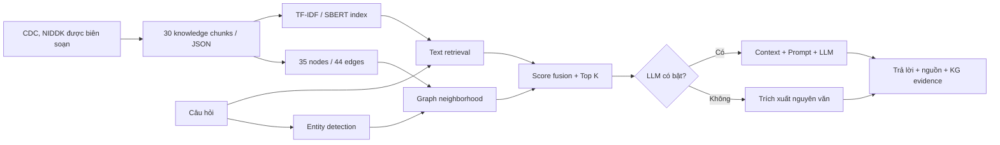

# KGandRAG_01 — Diabetes Knowledge Graph + RAG

**Demo đồ án: Knowledge Graph kết hợp Retrieval-Augmented Generation (RAG) cho chủ đề đái tháo đường**, có giao diện web, API, đánh giá retrieval và cấu hình triển khai.

> **Lưu ý y khoa:** Demo học thuật, **không phải** sản phẩm y tế, công cụ chẩn đoán hay phần mềm khuyến nghị điều trị. Không sử dụng với dữ liệu bệnh nhân thực, không tự điều chỉnh liều thuốc. Trong tình huống nguy hiểm hãy liên hệ cơ sở y tế/cấp cứu.

## 1. Có gì trong project?

| Chức năng | Cách triển khai |
|---|---|
| Knowledge Graph | 35 thực thể, 44 quan hệ có nhãn; duyệt đồ thị, tìm node, xem các quan hệ |
| Nguồn tri thức | 30 đoạn tài liệu tiếng Việt do nhóm biên soạn và gắn link **CDC / NIDDK (NIH)** để đối chiếu |
| Text retrieval | TF-IDF word + char n-gram (mặc định, nhẹ, offline) |
| KG retrieval | NER dựa trên alias tiếng Việt, mở rộng một-hop các thực thể liên quan, đánh điểm tài liệu |
| Hybrid retrieval | Kết hợp điểm text và KG; giải thích các thực thể khớp và nguồn tìm được |
| RAG generation | Kết nối **Ollama** hoặc **OpenAI-compatible API**; tạo đáp án từ các đoạn truy xuất và trích dẫn ID |
| Không có LLM | Trả các đoạn **trích xuất nguyên văn** có dẫn nguồn, không giả vờ đã gọi LLM |
| Embedding ngữ nghĩa (tùy chọn) | `sentence-transformers`, vector lưu RAM; cần cài thêm gói và tải model |
| Bảng đánh giá | 30 câu hỏi mẫu có nhãn; so sánh Text/KG/Hybrid theo Hit@K, Recall@K, Precision@K, MRR@K |
| Test và deploy | Pytest, FastAPI Swagger, Docker, Compose, Render Blueprint, GitHub Actions CI |

**Lưu ý phương pháp:** TF-IDF là biểu diễn vector thưa, **không phải** embedding từ transformer. Chế độ mặc định dùng retrieval từ văn bản + KG, sau đó **trích xuất**, còn chỉ khi bật `LLM_PROVIDER` mới có sinh câu trả lời bằng LLM. Có thể bật embedding transformer bằng `RETRIEVAL_ENCODER=sbert`. Không cần Neo4j/Chroma để chạy demo: KG trong JSON, vector index trong RAM, đều được load khi khởi động. Khi triển khai nghiên cứu lớn có thể thay bằng Neo4j và vector DB.

## 2. Chạy thử trên Windows / VS Code

Yêu cầu **Python 3.10+** (khuyến nghị 3.11), máy có Internet *khi cài thư viện*.

```powershell
cd KGandRAG_01
py -3.11 -m venv .venv
.\.venv\Scripts\Activate.ps1
pip install -r requirements-dev.txt
Copy-Item .env.example .env
python -m uvicorn app.main:app --reload --port 8000
```

Nếu không có lệnh `py -3.11`, thay bằng `python`. Nếu PowerShell chặn Activate, dùng Command Prompt với `.venv\Scripts\activate.bat` (hoặc gọi trực tiếp `.venv\Scripts\python.exe`).

Truy cập **http://127.0.0.1:8000** để mở giao diện, **http://127.0.0.1:8000/docs** để thử FastAPI Swagger, và **http://127.0.0.1:8000/api/health** để kiểm tra trạng thái.

Trên macOS/Linux:

```bash
cd KGandRAG_01
python3 -m venv .venv
source .venv/bin/activate
pip install -r requirements-dev.txt
cp .env.example .env
uvicorn app.main:app --reload --port 8000
```

**Mặc định ứng dụng hoạt động mà không cần API key, không cần GPU hay tài khoản bên thứ ba.** Câu trả lời lúc này là trích xuất bằng chứng, không phải văn bản do LLM viết.

## 3. Chạy qua Docker

```bash
cd KGandRAG_01
# Có thể tạo .env từ .env.example để thay đổi provider
cp .env.example .env
# Windows PowerShell: Copy-Item .env.example .env
docker compose up --build
```

Mở **http://localhost:8000**. Muốn dừng: `docker compose down`.

Dùng Docker không qua Compose:

```bash
docker build -t diabetes-graph-rag .
docker run --rm -p 8000:8000 diabetes-graph-rag
```

Các thư viện chạy app chỉ nằm trong `requirements.txt`, không yêu cầu database server hay phần mềm phụ trợ. Docker mặc định dùng TF-IDF và trích xuất. Nếu cần Ollama ở máy host, phải cấu hình địa chỉ host mà container truy cập được (ví dụ `host.docker.internal` trên môi trường hỗ trợ).

## 4. Bật LLM để tạo câu trả lời RAG thực sự

Sửa file `.env`, ví dụ cho API tương thích OpenAI:

```dotenv
LLM_PROVIDER=openai
LLM_BASE_URL=https://api.openai.com/v1
LLM_API_KEY=YOUR_PRIVATE_API_KEY
LLM_MODEL=gpt-4o-mini
RETRIEVAL_ENCODER=tfidf
```

Khởi động lại server. Khi hỏi, hệ thống truy xuất tài liệu → ghép CONTEXT → gửi Prompt cho LLM → nhận câu trả lời kèm trích dẫn `[Dxx]`. Nếu API lỗi, giao diện sẽ báo **chuyển về chế độ trích xuất**. **Không đẩy `.env` lên GitHub.** API của bên thứ ba có thể tính phí, và câu hỏi cùng CONTEXT sẽ được chuyển đến nhà cung cấp đã cấu hình; **không sử dụng thông tin bệnh nhân thực**.

Cho **Ollama cục bộ** (đã cài Ollama):

```bash
ollama pull llama3.2:3b
```

`.env`:

```dotenv
LLM_PROVIDER=ollama
LLM_BASE_URL=http://localhost:11434/v1
LLM_MODEL=llama3.2:3b
LLM_API_KEY=ollama
```

Đây là ví dụ về máy cục bộ; mô hình và tốc độ phụ thuộc phần cứng, khả năng tiếng Việt và các model cài đặt. Prompt yêu cầu dẫn chứng và tránh phác đồ cá nhân; tuy nhiên LLM **vẫn có thể sai/hallucinate**, cần kiểm chứng thủ công.

### Tùy chọn: Embedding ngữ nghĩa thật

Trên môi trường Python (không phải Dockerfile nhẹ mặc định):

```bash
pip install -r requirements-semantic.txt
```

Bật trong `.env`:

```dotenv
RETRIEVAL_ENCODER=sbert
EMBEDDING_MODEL=sentence-transformers/paraphrase-multilingual-MiniLM-L12-v2
```

Khi chạy lần đầu, thư viện tải model từ Internet và tạo vector in-memory từ dữ liệu. Cấu hình này nặng RAM và thời gian khởi động hơn. Bảng so sánh lúc đó dùng dense semantic embeddings thay cho TF-IDF trong nhánh Text. **Chưa có bản image Docker tích hợp model này**; nếu muốn dùng Docker, cần bổ sung `requirements-semantic.txt` vào bước cài đặt của Dockerfile và cấu hình bộ nhớ phù hợp.

## 5. Chạy test và đánh giá

```bash
python -m pytest -q
python -m scripts.run_evaluation --k 3
```

Xem file tạo ra:

- `eval/reports/summary.csv`: bảng tổng hợp số liệu, mở bằng Excel.
- `eval/reports/details.csv`: **90 dòng** kết quả từng câu hỏi x ba phương pháp.
- `eval/reports/results.json`: toàn bộ kết quả và thời điểm chạy.
- `eval/EVALUATION.md`: cách tính và diễn giải.

Hoặc nhấn **Bảng đánh giá → Chạy đánh giá** trên giao diện, chọn `K = 1`, `3` hoặc `5` và xuất CSV. Tập nhãn gốc nằm tại `eval/questions.json` (có thể thay bằng tập câu hỏi độc lập của nhóm).

Bảng kiểm thử an toàn và API có trong `tests/test_engine.py`. Truy vấn ngẫu nhiên không liên quan được kiểm tra để thử cơ chế từ chối bằng chứng không phù hợp; tình huống có mất ý thức, co giật hoặc yêu cầu chỉnh liều thuốc được xử lý theo cảnh báo an toàn.

## 6. Triển khai trên Render

1. Tạo repository GitHub chứa **nguyên thư mục project** (sao cho `Dockerfile`, `render.yaml` nằm tại root repo).
2. Trên Render chọn **New → Blueprint**, kết nối repo chứa `render.yaml`, xem lại tên service và cấu hình gói máy theo lựa chọn của bạn.
3. Deploy. Render sẽ build Docker image và dùng endpoint `/api/health` để health check.
4. Bản mặc định không có API key chạy được ngay. Nếu dùng LLM, thiết lập `LLM_PROVIDER`, `LLM_BASE_URL`, `LLM_MODEL`, `LLM_API_KEY` trong Environment của Render.

**Không có URL công khai sẵn** trong file vì cần tài khoản Render/GitHub của bạn để thực sự triển khai. Quyền truy cập public với LLM có nguy cơ tiêu thụ API và cần thêm xác thực/rate limit trước khi cho người dùng ngoài nhóm sử dụng. Chi phí và hạn mức Render tùy gói và thời điểm.

## 7. API thử nghiệm

Ví dụ:

```bash
curl -X POST http://localhost:8000/api/chat \
  -H 'Content-Type: application/json' \
  -d '{"question":"HbA1c bao nhiêu thì là tiểu đường?", "mode":"hybrid", "top_k":3}'
```

| Endpoint | Chức năng |
|---|---|
| `GET /` | Web demo (giao diện chat, KG, benchmark) |
| `GET /api/health` | Health check |
| `GET /api/stats` | Số node, cạnh, tài liệu, câu hỏi |
| `POST /api/chat` | `question`, `mode=vector/graph/hybrid`, `top_k=1…8` |
| `GET /api/graph?q=thận` | Lấy graph xung quanh thực thể được tìm thấy |
| `GET /api/evaluation?k=3` | So sánh 3 phương pháp và điểm từng câu hỏi |
| `GET /docs` | Swagger UI |

## 8. Kiến trúc và cách hoạt động



**Pha chuẩn bị (offline):** `scripts/seed_data.py` tạo bộ tri thức và các triple có nhãn; ứng dụng đọc JSON, lập vector index và bảng quan hệ tại thời điểm khởi động. **Pha online:** câu hỏi → chuyển vector → phát hiện thực thể → tìm lân cận → hợp nhất điểm → chọn Top-K → LLM hoặc trích xuất → UI hiển thị bằng chứng.

Công thức thực thi ở chế độ mặc định:

- Text similarity: `s_text = 0,7 * cosine(TF-IDF-char) + 0,3 * cosine(TF-IDF-word)`.
- Knowledge Graph: đánh điểm theo các thực thể xuất hiện trực tiếp và lân cận 1-hop; thực thể tổng quát có trọng số thấp hơn.
- Hybrid: `s_hybrid = 0,72 * s_text + 0,28 * s_KG`.
- Top-K: lấy K mục có điểm cao nhất trên tập tài liệu, giới hạn câu trả lời khi bằng chứng quá yếu.
- Khi bật SBERT, `s_text` được thay bằng cosine của dense embeddings được chuẩn hóa.

Đây là **thiết kế thử nghiệm**, chưa có truy vấn Cypher/Neo4j, reranker học sâu hay cơ chế đánh giá factual grounding tự động. Hệ thống KG hoạt động bằng thuật toán trên graph JSON và đồ thị SVG không dùng CDN. Có thể thay thế các thành phần này khi mở rộng đề tài.

### Cấu trúc thư mục

```text
KGandRAG_01/
├── app/
│   ├── main.py               # FastAPI endpoints
│   ├── engine.py             # Text + graph retrieval; optional LLM
│   ├── evaluation.py         # Hit, Recall, Precision, MRR
│   └── static/
│       ├── index.html        # Dashboard UI
│       ├── style.css
│       └── main.js           # Chat, KG SVG, benchmark
├── data/
│   ├── documents.json        # 30 chunks + official source URLs
│   └── graph.json            # Nodes, triples and source doc IDs
├── eval/
│   ├── questions.json        # 30 test questions, gold docs
│   ├── EVALUATION.md
│   └── reports/              # CSV + JSON actual results
├── scripts/
│   ├── seed_data.py          # Rebuild curated seed
│   └── run_evaluation.py
├── tests/test_engine.py
├── .github/workflows/tests.yml
├── Dockerfile
├── docker-compose.yml
├── render.yaml
├── .env.example
├── requirements.txt
├── requirements-dev.txt
├── requirements-semantic.txt
└── README.md
```

## 9. Nguồn y khoa, hạn chế và trách nhiệm khi sử dụng

Các nội dung tiếng Việt được **biên soạn lại ngắn gọn**, không phải trích dẫn nguyên văn hay bộ hướng dẫn y tế chính thức. Mỗi mục có `source_url` trong `data/documents.json`. Nguồn tham khảo:

- CDC – Diabetes Testing: https://www.cdc.gov/diabetes/diabetes-testing/index.html
- CDC – A1C Test: https://www.cdc.gov/diabetes/diabetes-testing/prediabetes-a1c-test.html
- CDC – Treatment of Low Blood Sugar: https://www.cdc.gov/diabetes/treatment/treatment-low-blood-sugar-hypoglycemia.html
- CDC – Diabetic Ketoacidosis: https://www.cdc.gov/diabetes/about/diabetic-ketoacidosis.html
- NIDDK – What Is Diabetes?: https://www.niddk.nih.gov/health-information/diabetes/overview/what-is-diabetes/
- NIDDK – Managing Diabetes: https://www.niddk.nih.gov/health-information/diabetes/overview/managing-diabetes
- NIDDK – Preventing Diabetes Problems: https://www.niddk.nih.gov/health-information/diabetes/overview/preventing-problems

**Giới hạn quan trọng:** Nội dung y khoa không được chuyên gia y tế thẩm định, tập đánh giá nhỏ và không độc lập, không thử nghiệm trên bệnh nhân, không phân tích kết quả xét nghiệm cá nhân, không bảo đảm mọi câu hỏi đều được trả lời đúng. Không nên đưa thông tin cá nhân nhạy cảm vào câu hỏi. Để sử dụng trong hệ thống y tế thật cần rà soát kiến thức, kiểm thử tính an toàn, xác thực người dùng, giám sát truy cập, quản lý dữ liệu cá nhân và đánh giá độc lập theo quy định áp dụng.
