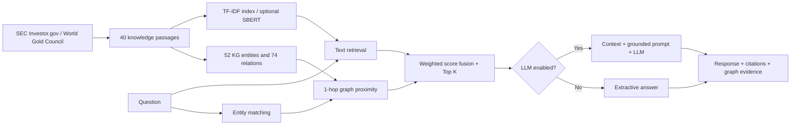

# KGandRAG_01 — Knowledge Graph + RAG cho Chứng khoán & Vàng

> **Market Atlas** — project FastAPI + web dashboard tiếng Việt, chạy local hoặc triển khai qua Docker/Render. Bộ dữ liệu gồm **40 đoạn tri thức**, **52 thực thể**, **74 quan hệ** và **40 câu hỏi đánh giá**. Cập nhật demo: tháng 10/2026.

**Mục đích:** Trình diễn Knowledge Graph và Retrieval-Augmented Generation (RAG) về **đầu tư cổ phiếu, thị trường chứng khoán, vàng và những yếu tố kết nối hai loại tài sản** như lãi suất, USD, lạm phát và đa dạng hóa danh mục.

**Giới hạn bắt buộc:** Ứng dụng **không kết nối giá trực tiếp** và **không cung cấp tín hiệu mua/bán, dự báo giá hay tư vấn đầu tư cá nhân**. Các tài liệu là diễn giải giáo dục từ nguồn tham khảo (SEC Investor.gov, World Gold Council), không phải bản sao nguyên văn hoặc dịch vụ tư vấn tài chính. Giá thị trường, quy định giao dịch và thuế có thể thay đổi; cần xác minh tại nguồn chính thức trước khi sử dụng.

## 1. Chức năng chính

| Thành phần | Đã cài đặt |
|---|---|
| **Knowledge Graph** | Đồ thị 52 nút, 74 cạnh có nhãn, nhóm Cổ phiếu / Vàng / Vĩ mô / Phân tích / Rủi ro / Quản trị; bấm nút để xem quan hệ, lọc theo tên thực thể |
| **Text retrieval** | TF-IDF từ và ký tự n-gram chạy offline, không cần tải model |
| **Graph retrieval** | Nhận diện thực thể bằng alias tiếng Việt, mở rộng 1-hop, đánh điểm mức liên quan tài liệu |
| **Hybrid retrieval** | Kết hợp điểm text và đồ thị: 0,72 Text + 0,28 KG; Top-K có giải thích điểm số |
| **Optional transformer embedding** | Bật `RETRIEVAL_ENCODER=sbert` để dùng sentence-transformers (tải model lần đầu) |
| **Generation** | Có LLM: prompt dựa trên context và trích dẫn ID; không có LLM: trích xuất đoạn nguồn thay vì giả vờ gọi model |
| **Giao diện demo** | Ba tab: Hỏi đáp / Đồ thị / Bảng đánh giá; hiển thị nguồn, điểm retrieval, nút graph, số liệu |
| **Đánh giá** | 40 câu hỏi, ba phương pháp (Text, KG, Hybrid), Hit@K / Recall@K / Precision@K / MRR@K, xem từng câu, xuất CSV |
| **Kiểm thử & triển khai** | 15 bài pytest, API Swagger, CI GitHub Actions, Docker/Compose, cấu hình Render |

### Ví dụ hỏi đáp

- “Cổ phiếu là gì, khác vàng ở điểm nào?”
- “Hệ số P/E và EPS dùng để đánh giá điều gì?”
- “Lãi suất thực tăng ảnh hưởng đến vàng ra sao?”
- “Vì sao vàng trong nước khác giá vàng quốc tế?”
- “ETF vàng khác vàng miếng thế nào?”
- “Lạm phát, USD và lãi suất liên quan đến giá vàng như thế nào?”
- “Đa dạng hóa vàng và cổ phiếu có thể giảm rủi ro không?”
- “Giá vàng hôm nay bao nhiêu?” → hệ thống **nêu rõ không có dữ liệu trực tiếp**, không bịa giá.

## 2. Chạy local trên Windows / VS Code

Yêu cầu Python **3.10+** (khuyến nghị Python 3.11) và Internet khi cài thư viện.

```powershell
cd KGandRAG_01
py -3.11 -m venv .venv
.\.venv\Scripts\Activate.ps1
pip install -r requirements-dev.txt
Copy-Item .env.example .env
python -m uvicorn app.main:app --reload --port 8000
```

Nếu máy không có `py -3.11`, dùng `python -m venv .venv`. Nếu PowerShell không cho chạy script kích hoạt, dùng **Command Prompt** và `\.venv\Scripts\activate.bat`, hoặc gọi `\.venv\Scripts\python.exe` trực tiếp.

Trên macOS hoặc Linux:

```bash
cd KGandRAG_01
python3 -m venv .venv
source .venv/bin/activate
pip install -r requirements-dev.txt
cp .env.example .env
python -m uvicorn app.main:app --reload --port 8000
```

Mở:

- **Giao diện:** http://localhost:8000
- **Swagger (thử REST API):** http://localhost:8000/docs
- **Kiểm tra dịch vụ:** http://localhost:8000/api/health
- **Đồ thị JSON:** http://localhost:8000/api/graph?q=vang (hoặc `?q=lãi%20suất`)
- **Thống kê:** http://localhost:8000/api/stats
- **Đánh giá:** http://localhost:8000/api/evaluation?k=3

Mặc định ứng dụng **không yêu cầu API key, database hay GPU** và trả lời bằng các đoạn văn được truy xuất có ID nguồn. Đó là **extractive QA**, không phải sinh văn bản bởi LLM.

## 3. Bật LLM để demo Generation của RAG

### API tương thích OpenAI

Chỉnh file `.env`:

```dotenv
LLM_PROVIDER=openai
LLM_BASE_URL=https://api.openai.com/v1
LLM_API_KEY=YOUR_PRIVATE_API_KEY
LLM_MODEL=gpt-4o-mini
RETRIEVAL_ENCODER=tfidf
```

Có thể dùng nhà cung cấp API tương thích OpenAI bằng cách thay `LLM_BASE_URL`, `LLM_MODEL`, `LLM_API_KEY`. **Không commit key lên Git hoặc để key trong frontend.**

### Ollama local (không bắt buộc API trả phí)

Cài Ollama và tải một model hỗ trợ tiếng Việt theo khả năng máy, ví dụ:

```bash
ollama pull llama3.2:3b
ollama serve
```

`.env`:

```dotenv
LLM_PROVIDER=ollama
LLM_BASE_URL=http://localhost:11434/v1
LLM_MODEL=llama3.2:3b
LLM_API_KEY=ollama
```

Nếu Ollama đã được khởi động dưới dạng service thì không cần chạy `ollama serve` lần nữa. Trong Docker, `localhost` trỏ tới container, **không phải** máy host; có thể cần `http://host.docker.internal:11434/v1` tùy hệ điều hành.

Mô hình LLM chỉ được cung cấp ngữ cảnh truy xuất, yêu cầu trích dẫn ID tài liệu và không bịa giá. **Prompt không chứng minh được đầu ra luôn đáng tin cậy**; vẫn phải đánh giá factuality/citation theo cách độc lập.

### Bật embedding ngữ nghĩa Transformer

```bash
pip install -r requirements-semantic.txt
```

`.env`:

```dotenv
RETRIEVAL_ENCODER=sbert
EMBEDDING_MODEL=sentence-transformers/paraphrase-multilingual-MiniLM-L12-v2
```

Chế độ này có thể tải model lúc khởi động và dùng RAM/CPU nhiều hơn. Mọi benchmark lưu sẵn chỉ phản ánh **TF-IDF** và cần chạy lại nếu bật `sbert`.

## 4. Chạy Docker & deploy

Docker Compose:

```bash
docker compose up --build
```

Mở http://localhost:8000; dừng bằng `docker compose down`.

Docker trực tiếp:

```bash
docker build -t stocks-gold-kg-rag .
docker run --rm -p 8000:8000 stocks-gold-kg-rag
```

**Render:** đẩy **thư mục project** lên GitHub, tạo Render Blueprint từ repo chứa `render.yaml`, rồi triển khai web service Docker. File `render.yaml` đặt `LLM_PROVIDER=none`, `RETRIEVAL_ENCODER=tfidf`, health check `/api/health`. Để dùng LLM, thêm environment variables trong trang quản trị Render; không để key trong repo. Nhà cung cấp hosting có thể tính phí; Render dùng cấu hình `plan: starter`, bạn có thể chỉnh plan cho phù hợp.

> Chưa có website công khai nào được deploy trong gói nguồn. `render.yaml` và `Dockerfile` là **cấu hình triển khai**, không phải chứng nhận đã deploy thành công lên dịch vụ thực.

## 5. Chạy kiểm thử và đánh giá

```bash
pytest -q
python -m scripts.run_evaluation --k 3
```

Chạy từ thư mục gốc, lệnh thứ hai cập nhật:

- `eval/reports/summary.csv`: một hàng cho mỗi chế độ Text / KG / Hybrid.
- `eval/reports/details.csv`: tài liệu chuẩn, Top-K nhận được, điểm của từng câu hỏi.
- `eval/reports/results.json`: dữ liệu đầy đủ để phân tích, có thời điểm chạy UTC.

**Kết quả thực nghiệm hiện tại (TF-IDF, K=3, 40 câu hỏi):**

| Phương pháp | Hit@3 | Recall@3 | Precision@3 | MRR@3 |
|---|---:|---:|---:|---:|
| Text TF-IDF | 100,0% | 100,0% | 33,3% | 0,975 |
| Graph-only | 87,5% | 87,5% | 29,2% | 0,733 |
| Hybrid (Text + KG) | 100,0% | 100,0% | 33,3% | 0,975 |

Bộ này dùng mỗi câu hỏi có **một tài liệu chuẩn**, nên Precision@3 tối đa chỉ 1/3 (33,3%) dù Hit@3 đạt 100%. Tập hỏi được xây dựng từ chính kho tài liệu → **không phải benchmark độc lập**. Hybrid không cải thiện điểm so với Text trong tập này, nên không tuyên bố hệ thống kết hợp ưu việt hơn. Chi tiết giới hạn và cách mở rộng trong `eval/EVALUATION.md`.

### Test thử HTTP API

```bash
curl -X POST http://localhost:8000/api/chat \
  -H 'Content-Type: application/json' \
  -d '{"question":"Lãi suất thực ảnh hưởng giá vàng như thế nào?","mode":"hybrid","top_k":3}'
```

Trên Windows PowerShell, dùng `Invoke-RestMethod` hoặc mở Swagger để nhập JSON trực tiếp.

## 6. Kiến trúc chương trình



**Offline:** `scripts/seed_data.py` tạo lại `data/documents.json`, `data/graph.json`, `eval/questions.json`; khi ứng dụng khởi động, engine đọc JSON, tạo chỉ mục TF-IDF (hoặc SBERT) và danh sách lân cận của đồ thị.

**Online:** nhận câu hỏi → chuẩn hóa và vector hóa → tìm thực thể khớp alias → tính điểm đồ thị qua các quan hệ một-hop → trộn điểm Text/KG → chọn Top-K → trích xuất hoặc cho LLM sinh câu trả lời → giao diện hiển thị liên kết chứng cứ.

Công thức ở chế độ mặc định:

- `s_text = 0.7 × cosine(char-TFIDF) + 0.3 × cosine(word-TFIDF)`.
- `s_graph = điểm khớp thực thể trực tiếp + lân cận một-hop (có trọng số)`.
- `s_hybrid = 0.72 × s_text + 0.28 × s_graph`.

Đây là mô hình **in-memory JSON Graph**, chưa sử dụng Neo4j/Cypher, cơ sở vector chuyên dụng hoặc reranker. Mục tiêu là minh họa kiến trúc **KG + RAG** với cài đặt đơn giản nhất có thể chạy demo offline.

## 7. Các API

| Endpoint | Chức năng |
|---|---|
| `GET /` | Giao diện Market Atlas |
| `GET /api/health` | Kiểm tra trạng thái |
| `GET /api/stats` | Số docs/nodes/edges và cấu hình hiện hành |
| `POST /api/chat` | `question`, `mode: hybrid/vector/graph`, `top_k: 1..8` |
| `GET /api/graph?q=lãi%20suất` | Subgraph theo thực thể và các nút lân cận |
| `GET /api/evaluation?k=3` | Benchmark ba chế độ + kết quả từng câu hỏi |
| `GET /docs` | Giao diện Swagger |

## 8. Cấu trúc thư mục

```text
KGandRAG_01/
├── app/
│   ├── main.py                 # FastAPI
│   ├── engine.py               # Text/KG/Hybrid retrieval & optional LLM
│   ├── evaluation.py           # Hit / Recall / Precision / MRR
│   └── static/
│       ├── index.html          # 3-tab dashboard
│       ├── style.css
│       └── main.js             # Retrieval + graph SVG + benchmark
├── data/
│   ├── documents.json          # 40 Vietnamese passages + source URLs
│   └── graph.json              # 52 nodes + 74 labeled edges
├── eval/
│   ├── questions.json          # 40 labeled evaluation questions
│   ├── EVALUATION.md
│   └── reports/                # actual CSV and JSON scores
├── scripts/
│   ├── seed_data.py            # regenerate content, graph and test questions
│   └── run_evaluation.py
├── tests/test_engine.py
├── .github/workflows/tests.yml
├── .env.example
├── Dockerfile
├── docker-compose.yml
├── render.yaml
└── requirements*.txt
```

## 9. Nguồn tham khảo và giới hạn dữ liệu

Nội dung tiếng Việt được nhóm biên soạn lại để mô phỏng corpus RAG và có `source_url` tham khảo theo nhóm kiến thức. Các URL hỗ trợ nghiên cứu khái niệm chung, **không có nghĩa mỗi câu trong đoạn đã được nguồn đó chứng nhận nguyên văn**.

1. SEC Investor.gov — Stocks: https://www.investor.gov/introduction-investing/investing-basics/investment-products/stocks
2. SEC Investor.gov — Asset Allocation & Diversification: https://www.investor.gov/introduction-investing/getting-started/asset-allocation
3. SEC Investor.gov — Investment Products: https://www.investor.gov/introduction-investing/investing-basics/investment-products
4. SEC Investor.gov — Stop/Stop-limit orders: https://www.investor.gov/introduction-investing/general-resources/news-alerts/alerts-bulletins/investor-bulletins-15
5. World Gold Council — How to invest in gold: https://www.gold.org/goldhub/how-to-invest
6. World Gold Council — What drives gold?: https://www.gold.org/goldhub/research/what-drives-gold
7. World Gold Council — Gold Mid-Year Outlook 2026: https://www.gold.org/goldhub/research/gold-mid-year-outlook-2026

**Không bao gồm:** giá theo mã chứng khoán ngày/giờ thực, giá mua/bán vàng SJC theo thời điểm, API cấp phép, thông tin tài khoản giao dịch, giao dịch thực, dự báo xu hướng có kiểm định, các khuyến nghị cá nhân.

**Để phát triển lên bản nghiên cứu nâng cao:** tích hợp cơ sở Neo4j + vector DB, ingestion PDF/website có theo dõi thời gian phiên bản, truy vấn đa bước, tập kiểm tra ngoài miền, phương pháp hybrid reranking và đánh giá LLM faithfulness; phần dữ liệu thị trường nên dùng API có điều khoản sử dụng phù hợp và hiển thị nhãn thời gian, trễ dữ liệu.
